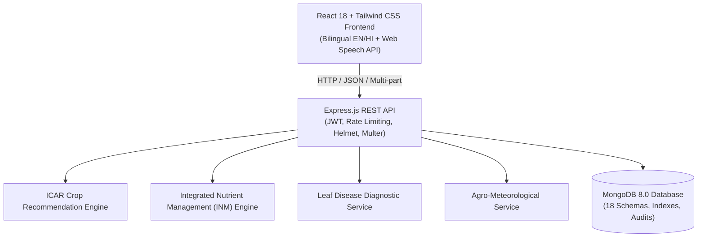

# Mitti Mitra Architecture & Scientific Methodology

## 1. Architectural Overview

## 2. Scientific Principles & Safeguards

### A. Photographic vs. Chemical Nutrient Separation
A normal smartphone camera photograph **cannot measure exact chemical values of Nitrogen, Phosphorus, Potassium, or soil pH**. Attempting to invent numbers from photographic pixels constitutes unscientific pseudoscience.
- Mitti Mitra distinguishes **Visual Surface Observations** (color, texture class, moisture indication, organic debris) from **Laboratory Wet-Chemistry Titrations**.
- Laboratory Soil Health Card measurements are requested for exact chemical dose calculations.

### B. 4R Nutrient Stewardship & Integrated Nutrient Management (INM)
- Right Source, Right Rate, Right Time, Right Place.
- Recommends combining 70% inorganic nutrients with 30% organic supplements (FYM, Vermicompost, Biofertilizers like Rhizobium and PSB).
- Mandates split-nitrogen application: 33% basal, 33% at Crown Root Initiation (CRI), and 33% at panicle emergence to minimize leaching and volatilization.

### C. Inconclusive Handling in Vision AI
- High-risk plant pathology algorithms must never force artificial certainty. If an uploaded leaf image is blurry, out-of-focus, or non-diagnostic, Mitti Mitra reports an explicit **Inconclusive Result** and directs the farmer to reshoot in natural daylight or consult local Krishi Vigyan Kendra (KVK) officers.

### D. Data Ownership & Isolation
- All user-specific records (soil reports, damage incidents, consultation queries, expenses) enforce strict ownership filters on every backend query.
- Administrative endpoints are protected via dual-layer middleware (`protect` + `authorize('admin')`).

